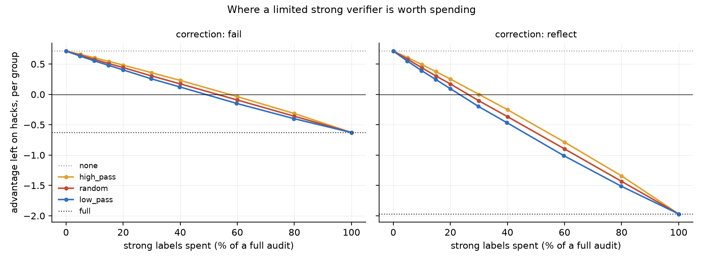
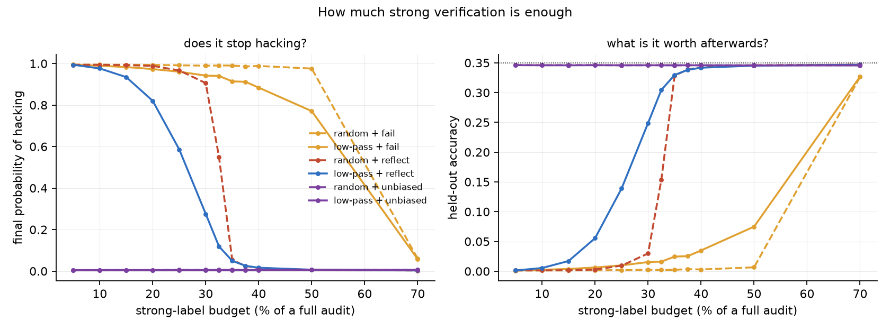

<h1 align="center">lb-audit</h1>

<p align="center">
  <a href="https://github.com/tatra-labs/lb-audit/actions/workflows/tests.yml"></a>
  <a href="https://arxiv.org/abs/2610.35716"></a>
  <a href="LICENSE"></a>
  
</p>

<p align="center"><b>Your unit tests can be gamed and your good verifier is too expensive to run.</b><br>
So run it where a hack would have been worth most: on the groups where almost nothing passed.
That ordering alone cuts the strong labels needed to stop reward hacking by a quarter.</p>

RLVR trains on a cheap verifier — unit tests, an exact-match check — and policies find ways to pass
it without solving anything. A stronger verifier would catch them and costs too much to run on
every rollout. [*Audit Where Hacks Pay*](https://arxiv.org/abs/2610.35716) (Li, Wang, Zeng and Wang,
October 2026) asks what to do with a fixed budget of strong checks, and answers with a rule simple
enough to drop into any GRPO trainer. No code was released.

**lb-audit** is that rule, the algebra behind it, and the simulations that say what it is worth.
Pure numpy, no model, no GPU, the whole thing runs in a couple of minutes.

```bash
pip install -e ".[dev,experiments]"
python experiments/advantage.py     # where the budget is worth spending
pytest -q                           # 27 tests
```

## Why low-pass groups

GRPO centres rewards inside each group, so what a rollout receives depends on what its siblings
did. A single pass among seven failures takes nearly the whole group's advantage; one pass among
eight takes none at all:

| passes in the group | advantage to each passing rollout |
|---:|---:|
| 1 of 8 | 0.875 |
| 2 of 8 | 0.750 |
| 4 of 8 | 0.500 |
| 7 of 8 | 0.125 |
| 8 of 8 | 0.000 |

If that pass is a hack, the number in the right column is exactly what the policy gradient pays it.
**Hacks pay most where least passed** — so that is where a rationed verifier should look.

The second half of the bargain is that those groups are also the cheapest to audit. A rollout that
already failed the cheap verifier needs no strong check; auditing a group costs one strong label
per *passing* rollout. Low-pass groups have the fewest passes. The ordering that removes the most
advantage is the one that costs the least per group, which is why it wins twice.

## What a budget buys

Advantage left sitting on hacks, per group, at a fixed policy. Lower is better; negative means the
update actively pushes *away* from hacking.

| strong labels spent | high-pass first | random groups | **low-pass first** |
|---:|---:|---:|---:|
| 0% | 0.713 | 0.713 | 0.713 |
| 10% | 0.492 | 0.439 | **0.394** |
| 20% | 0.253 | 0.172 | **0.098** |
| 30% | 0.001 | −0.105 | **−0.198** |
| 100% | −1.970 | −1.970 | −1.970 |

<sub>256 groups of 8, 40% hack rate among non-solutions, 20 seeds, `reflect` correction.
`python experiments/advantage.py`</sub>

Low-pass beats random beats high-pass at every budget and under both corrections — that ordering is
a test, not an observation. Put as a threshold, the budget each needs before hacks stop being
rewarded at all:

| | caught hack counts as a failure | caught hack is punished |
|---|---:|---:|
| high-pass first | 57.4% | 30.0% |
| random groups | 53.0% | 26.2% |
| **low-pass first** | **48.8%** | **23.1%** |

Two separate savings, and they multiply. Ordering by pass count saves about 12% of the labels
against random. Punishing a caught hack rather than merely discounting it halves the requirement
again. Together, **23.1% against 53.0%** — the naive combination needs 2.3× the strong verification
to reach the same place.



## The correction matters as much as the policy

When an audit catches a hack, what should it be worth?

```python
from lb_audit import caught_reward

caught_reward("fail")                            #  0.0  — as though it had simply failed
caught_reward("reflect")                         # -1.0  — as far below failure as a pass is above
caught_reward("unbiased", audit_probability=0.1) # -9.0  — scaled so the expectation is unbiased
```

`fail` only cancels the pull towards hacking. `reflect` reverses it: a caught hack becomes worse
than not answering, so the gradient points away rather than merely declining to point towards. That
is the whole difference between the two columns above.

`unbiased` divides by the audit probability so a hack's *expected* reward matches a full audit.
That is exact, and at a 10% budget it puts −9 on a single rollout.

## Does the threshold show up in training?

The advantage table is a prediction: below the threshold the gradient still points towards hacking,
so training should walk there; above it, it should not. `experiments/budget.py` runs the GRPO loop
across budgets and checks. Final probability of hacking after 400 steps, 6 seeds:

| budget | random + fail | low-pass + fail | random + reflect | **low-pass + reflect** | unbiased (either) |
|---:|---:|---:|---:|---:|---:|
| 10% | 0.994 | 0.989 | 0.994 | 0.976 | 0.005 |
| 20% | 0.993 | 0.973 | 0.989 | 0.820 | 0.005 |
| 25% | 0.991 | 0.960 | 0.966 | **0.586** | 0.006 |
| 30% | 0.989 | 0.942 | 0.905 | **0.275** | 0.006 |
| 32.5% | 0.990 | 0.940 | 0.550 | **0.119** | 0.006 |
| 35% | 0.990 | 0.914 | 0.054 | 0.049 | 0.006 |
| 50% | 0.976 | 0.771 | 0.006 | 0.007 | 0.006 |

The turnover happens where the static analysis said it would, and the gap between the two
`reflect` columns through the crossover is the whole argument for the ordering: **at a 32.5%
budget, random auditing still leaves the policy hacking half the time and low-pass has nearly
stopped it.** Spending the same labels in a different order is worth about five percentage points
of budget, which is the difference between a run that works and one that does not.




## Bias is not the whole story

The paper's closing point is that an audit scheme is not described by its expected update alone.
Holding the policy still and drawing 2,000 independent batches:

| scheme | mean | sd | sd / \|mean\| | batches pushing the wrong way |
|---|---:|---:|---:|---:|
| random + fail | 0.313 | 0.107 | 0.34 | 0.0% |
| low-pass + fail | 0.289 | 0.096 | 0.33 | 0.0% |
| random + reflect | −0.085 | 0.153 | 1.79 | 27.5% |
| **low-pass + reflect** | **−0.134** | 0.152 | **1.13** | **17.7%** |
| random + unbiased | −0.659 | 0.244 | 0.37 | 0.6% |
| low-pass + unbiased | −0.812 | 0.271 | 0.33 | 0.2% |

<sub>16 groups per batch, 30% budget. `python experiments/variance.py`</sub>

At the same budget low-pass points away from hacking **57% harder** than random, and roughly a third
fewer of its individual batches push the wrong way. But look at the right-hand column for the two
`reflect` rows: even the better of them sends a quarter of its steps in the wrong direction. A
scheme whose mean is correct can still be a coin flip step to step, which is exactly the thing the
paper says to watch.

## What reproduced and what did not

* **Low-pass ordering beats random, everywhere.** Reproduced cleanly, at a fixed policy and in
  training, at every budget and under every correction tested. This is the paper's main claim.
* **Reflecting the caught-hack reward matters more than the ordering does.** Reproduced, and it is
  the larger of the two effects here.
* **Unbiased corrections cost held-out accuracy.** *Did not reproduce.* The paper reports 6–12
  points lost against the low-pass scheme; in this simulation the unbiased correction is simply the
  best option at every budget, stopping hacking at 5% where `reflect` needs 30%+. Its variance is
  higher in absolute terms, but so is its signal, and the ratio does not degrade.

  That last point is worth being precise about rather than explaining away. A three-logit policy
  can absorb a −9 reward on one rollout; a language model cannot, and whatever damage that does is
  not visible in the advantage algebra this repository simulates. So the honest reading is that
  **the variance cost the paper measures does not come from the advantage estimator**, and a toy
  that models only the estimator will not find it. If you are choosing a correction for a real run,
  that is the one result here you should not lean on.

## Using it on a real trainer

The pieces are independent of the simulation. Given your batch's groups, with `passes` marking the
rollouts the cheap verifier accepted:

```python
from lb_audit import audit, caught_reward

spent = audit(groups, "low_pass", budget=your_strong_label_budget)
reward_for_caught = caught_reward("reflect")          # -1.0 with 1/0 rewards

for group in groups:
    rewards = group.rewards(correction=reward_for_caught)
    # ... then GRPO as usual: centre within the group, and update.
```

`audit` only ever marks passing rollouts, never spends more than the budget, and audits whole
groups — a half-audited group still contains unchallenged passes. All three are tested.

## What is the paper's, and what is not

* **The rule is the paper's**: low-pass budgeted audits, the reflected correction, and the framing
  of residual advantage mass as the thing to minimise.
* **The derivations here are a reading of it.** The paper states results about optimality among
  pass-count designs under stated assumptions; this repository checks the consequences numerically
  rather than reproving them, and `hack_advantage_if_unaudited` is written out here.
* **The experiments are not the paper's.** Its results are on LeetCode and Countdown-Code with real
  policies; everything here is a simulation with a three-action policy and synthetic groups, which
  is why the one claim that depends on a real model's fragility is the one that did not reproduce.

## Licence

MIT. Paper: [arXiv:2610.35716](https://arxiv.org/abs/2610.35716).
